# MyLokalEvent: v1 vs v2

A running record of how MyLokalEvent 2.0 improves on the original university project
([7YMERA/mylokalevent](https://github.com/7YMERA/mylokalevent)). Each meaningful change
adds an entry to the log at the bottom.

## At a glance

|                  | v1 (university project, 2026)                                               | v2 (this repo)                                                                                       |
| ---------------- | --------------------------------------------------------------------------- | ---------------------------------------------------------------------------------------------------- |
| Frontend         | Static Bootstrap 5 pages, vanilla JS SPA                                    | Next.js 16, React, TypeScript (strict), Tailwind CSS                                                 |
| Rendering        | Client-side only; search engines and WhatsApp previews see an empty page    | Server-rendered and statically generated pages                                                       |
| Brand            | Stock Bootstrap "water" icon beside the name; no favicon                    | Wau bulan logo in both themes, theme-aware favicon and app icon                                      |
| Styling          | Bootstrap defaults, one blue hue for almost everything                      | Design tokens: ocean teal, sunset coral and a distinct colour per event category                     |
| Dark mode        | None                                                                        | Light, dark and "match device", switchable, no flash on load                                         |
| Language         | English only                                                                | Bahasa Melayu and English on every page, with a switcher; language in the URL for search and sharing |
| Accessibility    | Not checked                                                                 | 60 automated WCAG AA contrast checks across both themes                                              |
| Auth             | Custom JWT stored in `localStorage`, 60-minute tokens, no revocation        | Supabase Auth with httpOnly cookies; suspension signs users out immediately                          |
| Data access      | Backend uses the all-powerful service key; no row-level rules               | Row Level Security on every table, tested with pgTAP                                                 |
| Secrets          | Default `change-me` JWT secret; admin and demo passwords in the public repo | App refuses to start with missing or placeholder secrets; no seeded accounts                         |
| Security headers | None                                                                        | CSP, HSTS, `nosniff`, frame blocking, referrer and permissions policies                              |
| Quality gates    | Manual testing, one smoke test script                                       | CI on every PR: lint, formatting, typecheck, unit tests, database tests, build, secret scanning      |
| Planning         | Course report                                                               | Kiro specs: requirements in EARS format, design, task list                                           |

## Screenshots

The v1 screenshots were taken from the original frontend code, run locally with the same
sample events as v2 so the comparison is like for like. v1 had no dark mode.

### Home page, desktop

| v1                                          | v2 light                                                 | v2 dark                                                |
| ------------------------------------------- | -------------------------------------------------------- | ------------------------------------------------------ |
| 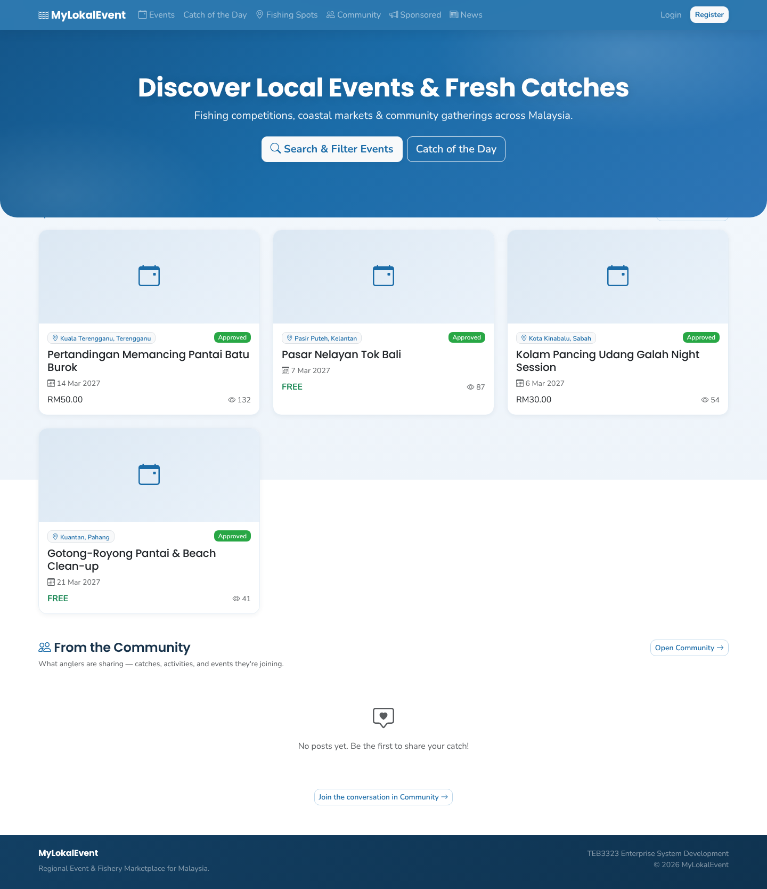 | 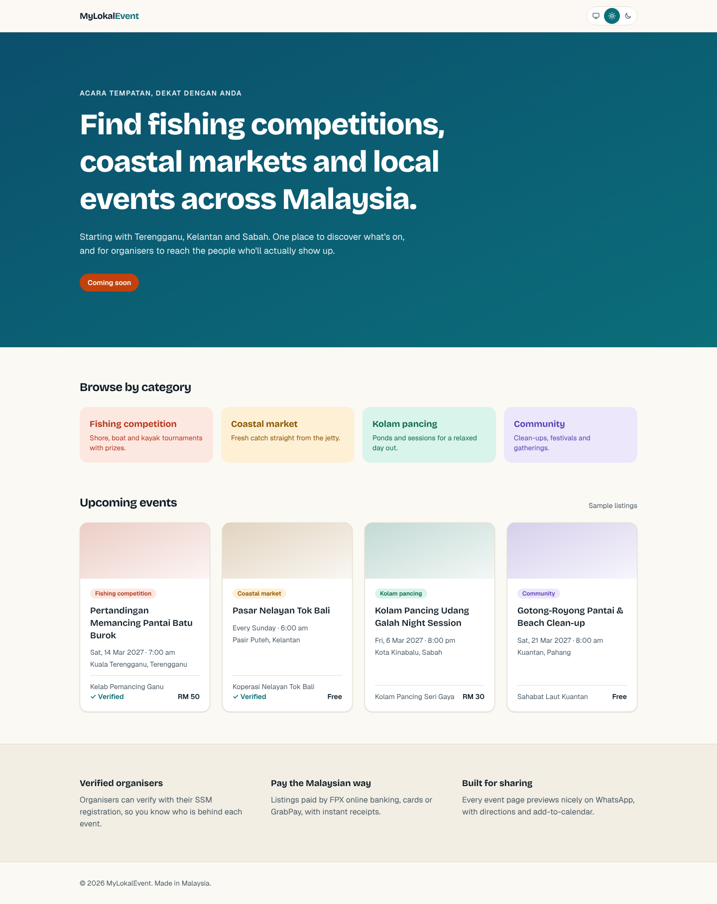 | 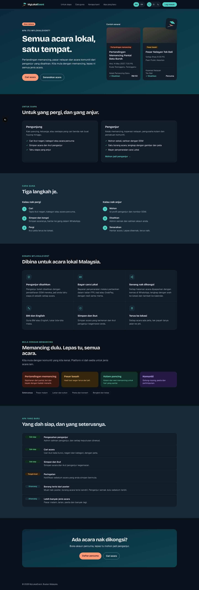 |

### Home page, mobile

| v1                                                 | v2 light                                                       | v2 dark                                                      |
| -------------------------------------------------- | -------------------------------------------------------------- | ------------------------------------------------------------ |
| 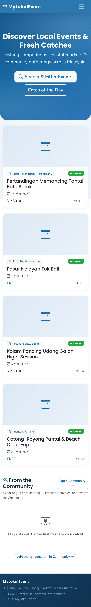 | 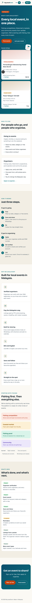 | 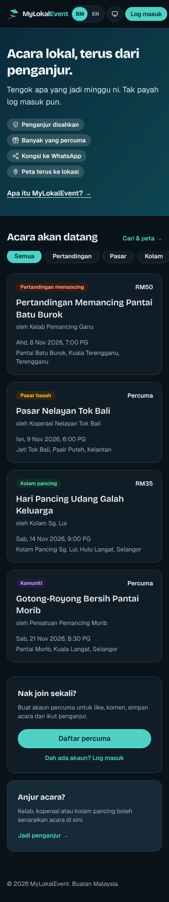 |

### Design system

v2 has a living style guide at `/design` showing every token and component in both themes.

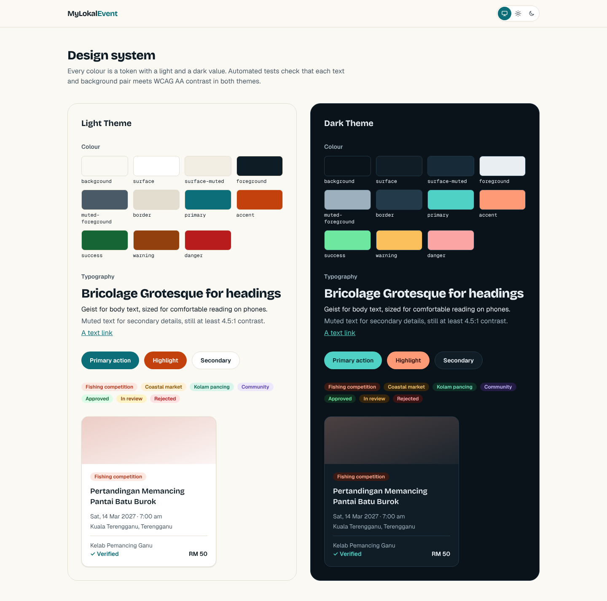

### Sign-in

v1 had one-click demo logins with shared passwords on the login page. v2 has none, checks
input on the server, keeps what you typed after an error, and never echoes the password.

| v1 login                                      | v2 sign in                                      | v2 sign-up errors, dark                                      |
| --------------------------------------------- | ----------------------------------------------- | ------------------------------------------------------------ |
| 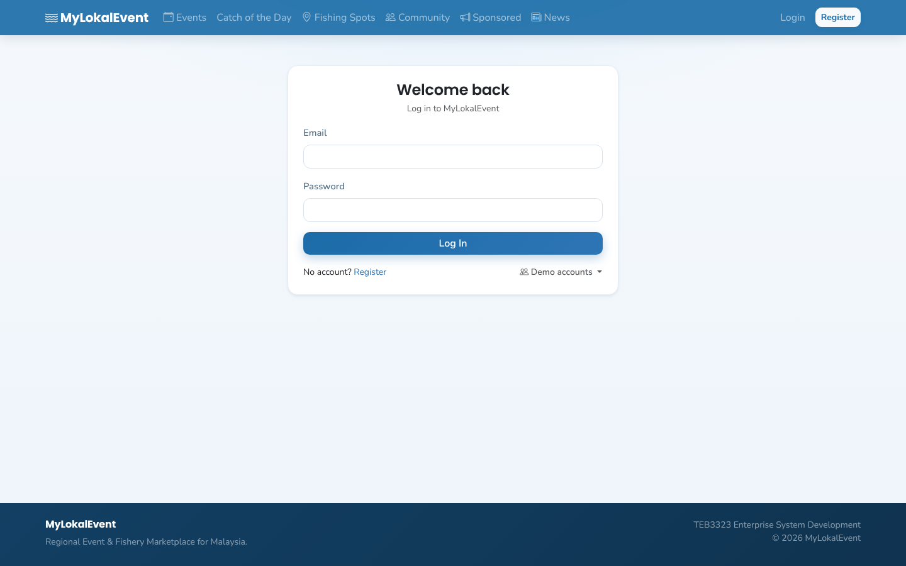 | 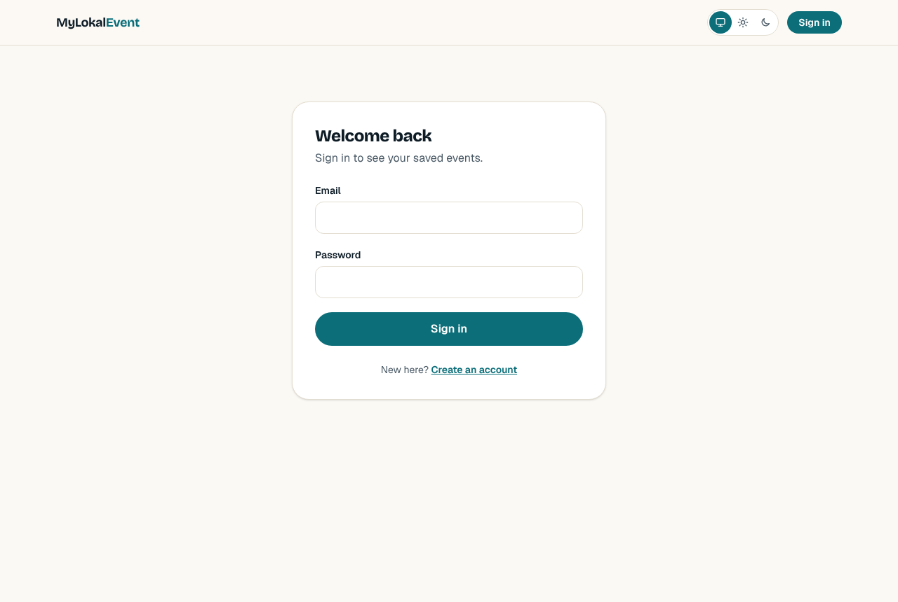 | 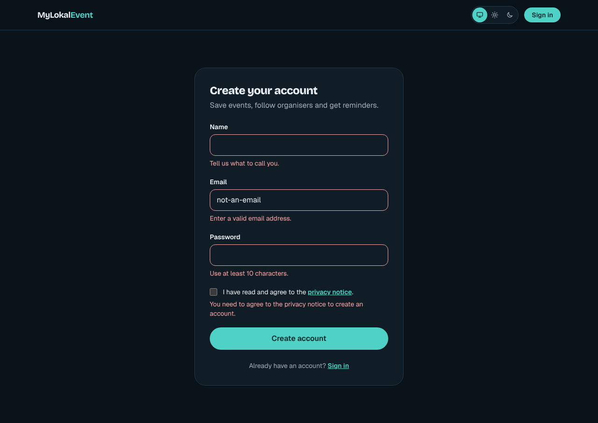 |

### Google sign-in

| v2 sign in with Google, BM                                             | v2 sign-up with Google, dark                                          |
| ---------------------------------------------------------------------- | --------------------------------------------------------------------- |
| 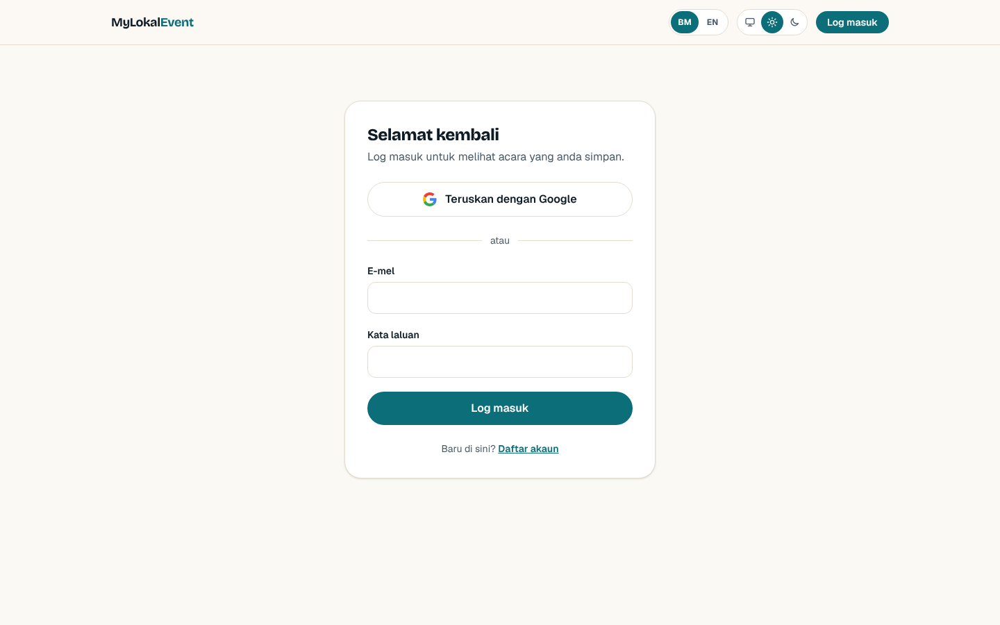 | 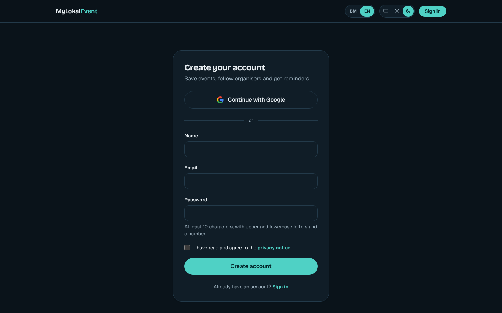 |

### Bahasa Melayu and English

v1 was English only. v2 opens in the visitor's language (BM unless their browser prefers
English), every page has a BM/EN switcher, and dates show in Malaysian time in either
language.

| v2 home, BM                                                | v2 sign-up errors, BM                                            |
| ---------------------------------------------------------- | ---------------------------------------------------------------- |
| 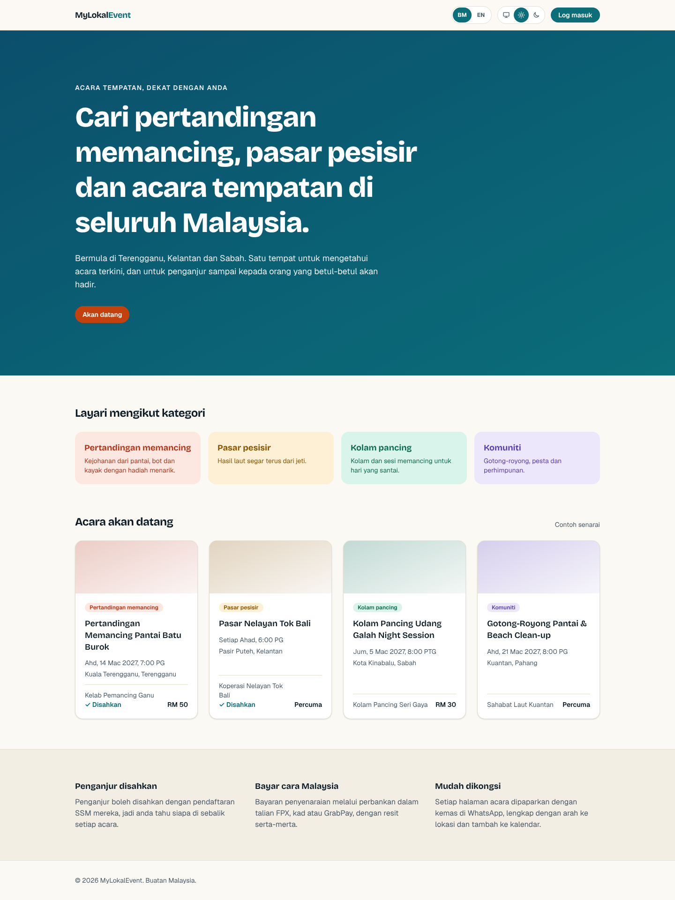 | 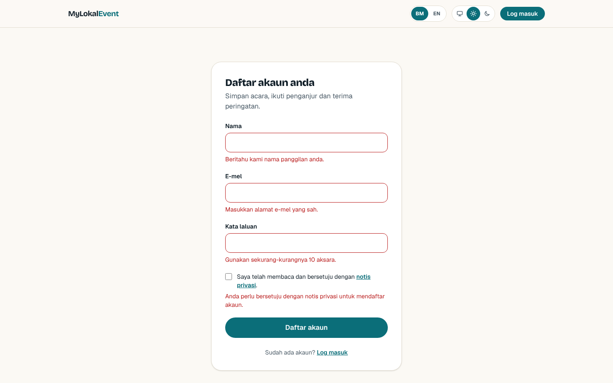 |

| v2 mobile, BM                                                    | v2 mobile, English, dark                                             |
| ---------------------------------------------------------------- | -------------------------------------------------------------------- |
| 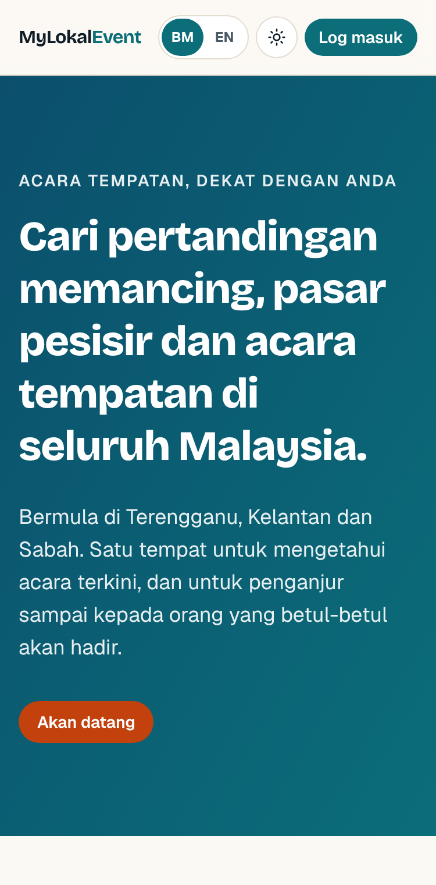 | 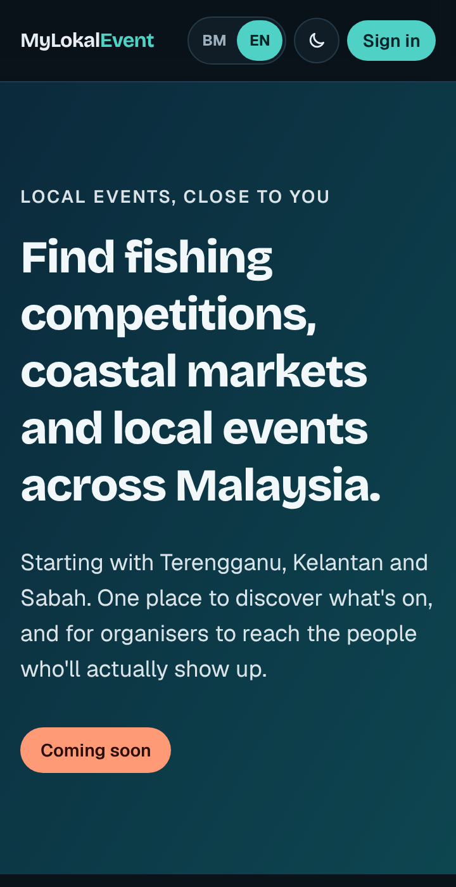 |

### Other v1 pages, for reference

| v1 events                                       |
| ----------------------------------------------- |
| 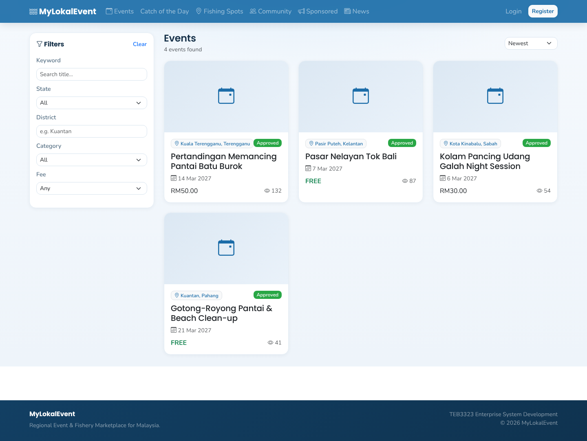 |

## Improvement log

Newest first. Link the pull request for each entry.

### 2026-10-27: Logo ([PR #15](https://github.com/7YMERA/mylokalevent-2.0/pull/15))

- **Before:** no logo of its own. The navbar showed the stock Bootstrap Icons "water"
  glyph next to the name in white, and the site had no favicon.
- **After:** a wau bulan (moon kite) mark, tilted in flight, beside the wordmark in the
  header, plus a favicon that follows the browser's light or dark setting and an Apple
  touch icon. It is drawn in the app's own colour tokens and contrast-checked in both
  themes. The kite says "Malaysian and festive" without tying the brand to fishing.

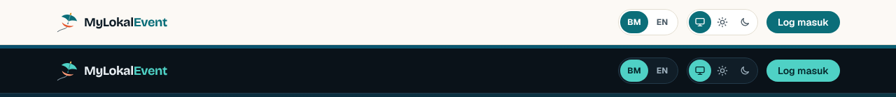

### 2026-10-25: Google sign-in

- **Before:** email and password only, with every new user typing a password they then
  had to remember.
- **After:** "Continue with Google" on the sign-in and sign-up pages, using Supabase's
  PKCE flow (the code verifier sits in an httpOnly cookie). Google can't carry our
  privacy-notice tick, so a first-time Google user goes to a "one last step" page and
  can't reach their account until they accept it. Consent is recorded by a database
  function so the timestamp always comes from the server, and pgTAP tests cover it.

### 2026-10-25: Bahasa Melayu and English

- **Before:** English only, so much of the audience (fishing communities on the east
  coast and in Sabah) read the site in their second language.
- **After:** every page in BM and English. The language is part of the URL (`/ms/...`,
  `/en/...`), so search engines index both and a link shared on WhatsApp opens in the
  sender's language. First visits follow the browser's language, falling back to BM, and
  the choice is remembered. Form errors, page titles and dates are translated too, and a
  test fails the build if a translation is missing or loses a placeholder.

### 2026-10-25: Sign-in with Supabase Auth ([PR #6](https://github.com/7YMERA/mylokalevent-2.0/pull/6))

- **Before:** a hand-rolled JWT stored in `localStorage` (readable by any injected script),
  60-minute tokens that kept working after a ban, demo accounts with public passwords, and
  a lockout that let anyone lock another user out by guessing their email.
- **After:** Supabase Auth with the session in an httpOnly cookie that JavaScript cannot
  read, refreshed by a proxy on every navigation and verified with `getClaims()` on the
  server. Email confirmation is required, passwords need 10+ characters with mixed case
  and a number, privacy consent is recorded at sign-up, and error messages don't reveal
  whether an email is registered. Rate limiting is handled by Supabase Auth.

### 2026-10-25: Design system and new landing page ([PR #5](https://github.com/7YMERA/mylokalevent-2.0/pull/5))

- **Before:** one blue used for nearly everything; no dark mode; colours hard-coded per page.
- **After:** a token-based palette (deep sea teal, sunset coral, warm sand neutrals) with a
  distinct colour for each event category. Every token has a light and a dark value, and a
  test fails the build if any text/background pair drops below WCAG AA contrast in either
  theme. A theme switcher remembers the choice without a flash of the wrong theme.
- **Why it matters:** text can no longer disappear when switching themes, and the site looks
  like a product rather than a template.

### 2026-10-25: Database access rules ([PR #4](https://github.com/7YMERA/mylokalevent-2.0/pull/4))

- **Before:** the backend used the Supabase service key for every query, so one bug could
  expose any table. Suspended users stayed signed in for up to an hour.
- **After:** Row Level Security on every table; users can only read and edit their own
  profile and can never change their own role. Suspending a user signs them out of every
  session and is written to an append-only audit log. 17 pgTAP tests run in CI.

### 2026-10-25: Project foundation ([PR #3](https://github.com/7YMERA/mylokalevent-2.0/pull/3))

- **Before:** the JWT secret defaulted to `change-me`, there were no security headers, and
  there was no CI.
- **After:** Next.js 16 with TypeScript strict mode; the server refuses to serve with missing
  or placeholder secrets; CSP, HSTS and related headers on every page; CI runs lint,
  formatting, typecheck, tests, build and secret scanning on every pull request.

### 2026-10-25: Planning ([PR #2](https://github.com/7YMERA/mylokalevent-2.0/pull/2))

- **Before:** a course report describing what was built.
- **After:** Kiro steering files and an MVP spec (requirements, design, tasks) written
  before any code, including a table mapping every v1 security weakness to its fix.
