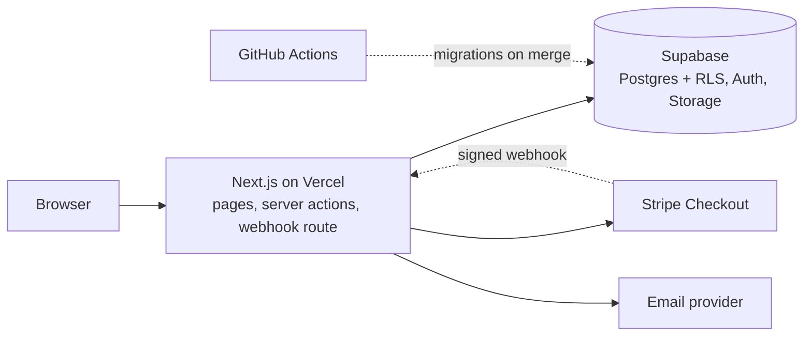
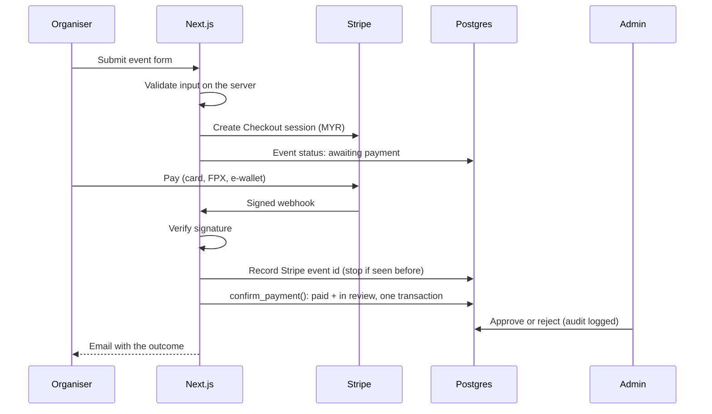

# Architecture

MyLokalEvent is one Next.js app on Vercel talking to Supabase. There is no separate API
server: pages and server actions run on Vercel, and the database enforces who can see
and change what.

## Principles

- **The database is the last line of defence.** Row Level Security is on for every
  table. The browser only ever holds the public (anon) key; the service key is used on
  the server, and only where RLS can't express a rule.
- **Anything that must be atomic lives in Postgres.** Approving, rejecting, suspending,
  verifying and confirming payments are Postgres functions that write the audit log in
  the same transaction.
- **Public pages are server-rendered.** Fast on slow mobile connections, indexable, and
  they preview properly when shared on WhatsApp (Open Graph and JSON-LD).
- **Localised routes.** Every page lives under `/ms/...` or `/en/...`.

## Data model

| Table           | What it holds                                                                 |
| --------------- | ----------------------------------------------------------------------------- |
| `profiles`      | One row per user: display name, role (member, organiser, admin), status       |
| `organisers`    | Organiser details and verification state (none, pending, verified, rejected)  |
| `categories`    | Event types, in BM and English, managed by admins                             |
| `events`        | The core entity: when, where, fee, coordinates and a review status            |
| `event_images`  | Photos per event, stored in Supabase Storage with non-guessable names         |
| `saved_events`  | Events a member saved, with an optional reminder                              |
| `follows`       | Organisers a member follows                                                   |
| `payments`      | Every payment attempt; readable by its owner, never writable from the browser |
| `stripe_events` | Stripe event ids already handled, so a webhook can't be processed twice       |
| `audit_log`     | Append-only trail of admin actions                                            |

## Who can do what

- Anyone can read approved events, their images, categories and organiser profiles.
- Organisers edit their own events while drafted or rejected; an edit to a live event
  sends it back for review.
- Members read and write only their own saves and follows.
- Status changes go through admin-only functions, each recorded in the audit log.
- Nobody can update or delete the audit log.

## Publishing an event

## Uploads

Photos are checked by their real file type (from the bytes, not the name), capped in
size, stripped of EXIF and GPS data, and stored under random names.

## Deployment

- **Vercel** builds and deploys the app from `main` only; other branches don't deploy.
- **GitHub Actions** runs CI on every pull request, and pushes new database migrations
  to Supabase when they merge to `main`.
- Secrets live in Vercel and GitHub settings, never in the repository. Every variable
  is documented with a placeholder in [`.env.example`](https://github.com/7YMERA/mylokalevent-v2/blob/main/.env.example).

The full design is in [`.kiro/specs/mvp/design.md`](https://github.com/7YMERA/mylokalevent-v2/blob/main/.kiro/specs/mvp/design.md).
